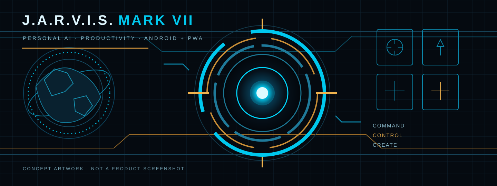
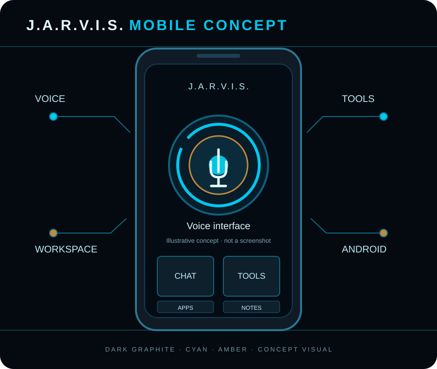

# J.A.R.V.I.S. Mark VII

<p align="center"></p>
<p align="center"><strong>A personal AI assistant and productivity command centre for web and Android.</strong></p>
<p align="center">
<a href="https://github.com/ansh71845/JARVIS-AI/actions/workflows/build-android-apk.yml"></a>
<a href="https://jarvis-1oa6whwst-ansh-0328.vercel.app">Open current preview</a> · <a href="README_ANDROID_INSTALL.md">Android installation guide</a> · <a href="www/privacy.html">Privacy policy</a>
</p>

> **Visual note:** Images in this README are concept illustrations for the J.A.R.V.I.S. visual direction, not screenshots of the running application.

## Overview

J.A.R.V.I.S. Mark VII is a client-side assistant interface that brings AI chat, voice interaction, personal workspace tools, device handoff, and live information into one application. The web experience is packaged for Android with Capacitor and can also run as a Progressive Web App.

The project is actively being hardened. The current engineering work is tracked in [Pull Request #1](https://github.com/ansh71845/JARVIS-AI/pull/1). The PR is intentionally kept in draft while physical-device checks and the remaining security review are completed.

## Visual direction

<p align="center"></p>

The interface direction uses a dark graphite base, restrained cyan highlights, amber accents, clear technical typography, and compact controls. Consult the live preview for the actual current interface.

## Current capabilities

| Area | What is implemented | Important limitation |
|---|---|---|
| AI assistant | Optional Gemini-powered chat using a user-supplied API key | The key is handled in the client. Do not use a shared production key here. |
| Voice | Browser voice input where supported, plus Android text-to-speech through the native bridge | Recognition and playback vary by browser and device. |
| Workspace | Local tasks, notes, calendar entries, saved memories, and macros | Data is stored in browser/app storage and is not encrypted by this app. |
| Android handoff | Native app-launch and phone-dialer handoff paths | Test installed-app resolution on the target Android device. |
| Network diagnostics | User-triggered public IP lookup and quick upload/download measurement | Public IP lookup contacts ipify; the quick test transfers about 1 MiB down and 256 KiB up through Cloudflare. |
| Location | Manual city selection and GPS only after an explicit user request and permission | GPS coordinates are sent to the disclosed geocoding/weather providers. |
| Weather | Current conditions and short daily forecasts from Open-Meteo | Requires a selected city or an approved GPS fix and an internet connection. |
| PWA | Service-worker app-shell caching and offline fallback | Offline mode does not make third-party AI, weather, search, or network tests available. |
| Code runner | Disposable Web Worker with a time limit and reduced application context | This is not a hardened security boundary for untrusted code. |

### Network and privacy behaviour

- Public IP lookup is off by default and requires an explicit action and confirmation.
- J.A.R.V.I.S. does not attempt WebRTC-based private/LAN IP discovery.
- Upload/download results are measured estimates, not guaranteed line-rate measurements, and are not persisted by the app.
- GPS is not requested automatically on page load. A denied or unavailable GPS request is shown as a failure, not a guessed location.
- The privacy policy lists third-party providers and the information sent to them.

Read [Privacy Policy](www/privacy.html) and [Terms](www/terms.html) before enabling network, AI, or location features.

## Technology

- **Web:** HTML, CSS, and JavaScript
- **Android:** Capacitor 6 with a small Java native bridge
- **PWA:** Web App Manifest and Service Worker
- **AI:** Optional Google Gemini API integration
- **Information services:** Open-Meteo, OpenStreetMap Nominatim, BigDataCloud, and ipify
- **Transfer test:** Cloudflare speed-test endpoints
- **Automation:** GitHub Actions for validation and Android debug APK builds
- **Preview hosting:** Vercel

## Run locally

### Requirements

- Node.js 20 or newer
- JDK 17 for the Android build
- Android SDK and platform tools for local APK compilation

### Web/PWA preview

```bash
git clone https://github.com/ansh71845/JARVIS-AI.git
cd JARVIS-AI
npm install
```

Serve the `www/` directory through localhost or HTTPS. Open `www/index.html` through a local server rather than relying on a `file://` URL. Browser microphone and geolocation features require browser support and a secure context.

### Build an Android debug APK

From a clean checkout:

```bash
npm install
npx cap add android
cp android-template/AndroidManifest.xml android/app/src/main/AndroidManifest.xml
mkdir -p android/app/src/main/java/com/stark/jarvis/os
cp android-template/src/main/java/com/stark/jarvis/os/NativeAssistantPlugin.java android/app/src/main/java/com/stark/jarvis/os/
npx cap sync android
cd android
./gradlew assembleDebug
```

APK output: `android/app/build/outputs/apk/debug/app-debug.apk`.

The generated APK is a **debug build**, not a Play Store release-signed package. See [README_ANDROID_INSTALL.md](README_ANDROID_INSTALL.md).

## Build and preview links

- [GitHub Actions workflow](.github/workflows/build-android-apk.yml)
- [Previously verified Android build](https://github.com/ansh71845/JARVIS-AI/actions/runs/46158797729)
- [Current Vercel audit preview](https://jarvis-1oa6whwst-ansh-0328.vercel.app)
- [Draft engineering PR #1](https://github.com/ansh71845/JARVIS-AI/pull/1)

The linked successful build verified JavaScript syntax, six network-diagnostics tests, static HTML IDs, canvas references, Capacitor sync, Android debug APK compilation, and artifact upload for its recorded commit. Later documentation changes trigger new workflow runs; use the Actions page for the latest result.

## Repository map

```text
www/
  index.html                 Application interface
  app.js                     Frontend application logic
  network-diagnostics.js     Public IP and transfer diagnostics
  sw.js                      PWA caching and offline fallback
  privacy.html               Privacy policy
  terms.html                 Terms and limitations
android-template/
  AndroidManifest.xml        Android permissions and package visibility
  src/main/java/...          Native Android bridge
.github/workflows/
  build-android-apk.yml      Validation and Android APK workflow
tests/
  network-diagnostics.test.cjs
assets/
  jarvis-mark-vii-concept.svg
  jarvis-interface-concept.svg
docs/
  ARCHITECTURE.md
  VALIDATION.md
```

## Roadmap and release gates

- Complete the control-by-control interaction and accessibility audit.
- Test GPS permission grant/denial, native app launch, speech, and lifecycle behaviour on a physical Android device.
- Test public IP lookup and upload/download measurement on mobile data and Wi-Fi, including offline and timeout cases.
- Complete offline first-load and service-worker upgrade testing on an installed PWA.
- Move shared Gemini credentials behind a server-side proxy before public distribution.
- Continue splitting the large frontend file into smaller testable modules.

**Release policy:** The current hardening PR remains a draft. A passing CI build is not a substitute for real-device testing or a complete security review.

## Contributing

Read [CONTRIBUTING.md](CONTRIBUTING.md) before opening a pull request. Report security concerns through the route described in [SECURITY.md](SECURITY.md), where available.

<p align="center"><strong>Build with purpose. Ship with evidence. Improve continuously.</strong></p>
